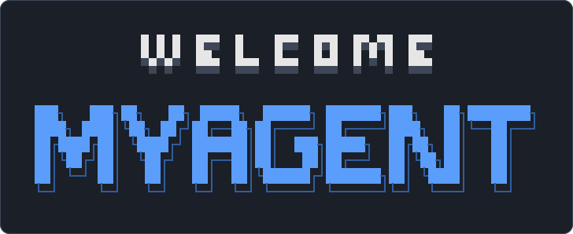

<p align="center">
  
</p>

# myagent

myagent 是一个跑在终端里的 coding agent：读懂你的代码库，改文件，跑命令和测试，把一件事从头做到尾。全部用自然语言交代。

它是从零手写的。ReAct 循环、工具调用、流式渲染、权限审批、上下文压缩、检查点回滚都是自己实现的，**不依赖任何 agent 框架**：后端 Java 17，第三方库只有 Jackson、OkHttp、Java-WebSocket 和 slf4j；界面用 OpenTUI 和 SolidJS。模型接 DeepSeek，任何 OpenAI 兼容的服务都行。

**[使用指南 →](docs/guide.md)**

myagent 按端分仓库，都在 [wiles-agent](https://github.com/wiles-agent) 组织下：

| 仓库 | 是什么 |
|---|---|
| **myagent-Harness**（本仓库） | Java 后端，也就是 agent 的 harness：包在模型外面的 ReAct 循环、工具调用、审批、上下文压缩、子 agent，以及协议定义（[docs/protocol.md](docs/protocol.md)） |
| [myagent-tui](https://github.com/wiles-agent/myagent-tui) | 终端界面，日常用的入口 |
| [myagent-android](https://github.com/wiles-agent/myagent-android) | 手机端，离开电脑时看进度、批准操作 |

## 快速开始

1. 准备 JDK 17+、[Bun](https://bun.sh) 和一个 DeepSeek API key，把终端界面拉下来：

   ```bash
   git clone https://github.com/wiles-agent/myagent-tui
   ```

2. 把 key 交给它：

   ```bash
   export DEEPSEEK_API_KEY=sk-xxx        # 或写进 ~/.myagent/config.json
   ```

3. 进到你的项目目录，启动：

   ```bash
   cd your-project
   /路径/到/myagent-tui/myagent-tui
   ```

第一次启动会先问你信不信任这个目录，然后在后台下载配套版本的后端（本仓库 Releases 里的 `myagent.jar`），界面马上就能打字。
想边改后端边用，把本仓库检出到本地，启动时带上 `MYAGENT_SERVER_DIR=<本仓库路径>`，界面会就地 build。
想在任何目录直接敲 `myagent`，把 `myagent-tui` 软链进 PATH 就行。换模型、换服务地址、调上下文窗口，见[使用指南的配置一节](docs/guide.md#快速开始)。

## 能做什么

### 修 bug、加功能

直接说要干什么，agent 自己决定读哪些文件、改哪里、跑什么命令验证。报错贴进来就行，三行以上的粘贴会折成一个占位符，不会把输入框撑满。截图也能贴：Mac 和 Linux 上按 `Ctrl+V`，Windows 上按 `Alt+V`，或者直接把图片文件拖进终端。

```
tests/test_paginate.py 有测试挂了，修好 src/paginate.py，别改测试
```

### 先出计划再动手

`Shift+Tab` 切到 plan 模式，agent 只读不改：把代码摸清楚、写出计划交给你。你批准之后它退回普通模式，接着照计划改；不批准可以附一句「别动数据库那层」，它改了再交。没切模式也没关系——碰上改动面大、做法要选的活，它会自己提议先规划，你同意才进。

### 放手让它改，改坏了就回滚

每次改动之前，工作区都会拍进一个不碰你 `.git` 的影子仓库。`/rewind` 能回到任何一次改动之前，可以只回文件、只回对话或者都回；`/undo` 撤掉上一轮。正因为回得去，覆盖这些文件不再逐次问你。`.env` 这类被忽略的文件、危险命令照样要你点头。

### 接上外部工具和浏览器

在 `~/.myagent/mcp.json` 里写上 MCP server，它们的工具就进了 agent 的菜单——平时只占一个名字，用到时才拉完整说明，接再多也不撑窗口。接上 `chrome-devtools-mcp` 之后，agent 能打开页面、点按钮、填表单、读 JS 动态生成的内容。浏览器操作按站点审批：对 `github.com` 选过「以后都同意」，换到别的站还会再问。

### 用技能和子 agent 扩展

技能用的是标准 `SKILL.md` 格式，`~/.claude/skills/` 下现成的那些直接能读，正文只在用到时才进上下文；也可以敲 `/技能名` 直接点名。碰上能并行的活、或者要翻一大片代码才答得上的问题，主 agent 会自己派子 agent 在后台同时干活；动手改代码的那种只能写分给它的文件，互相踩不到。想加确定性的规则（「消息里有密钥就拦下」），在 `~/.myagent/settings.json` 里配一条提交 hook，格式和 Claude Code 一样。

### 接着上次的对话

`/continue` 接最近那段，`/resume` 从历史里挑一段。上次的对话原样摆回屏幕，没跑完的那一轮说一句「继续」就从断点接着做。

### 离开电脑也能接着管

任务跑了十分钟、卡在等你授权，而你已经不在电脑前。装上 [myagent-android](https://github.com/wiles-agent/myagent-android) 手机端，界面里敲 `/qr` 扫码，就能在手机上看进度、批准操作。走中继时任何网络都能连，中继只看得见密文。

### 写进脚本和评测

```bash
java -jar target/myagent.jar --once prompt.txt -d ~/proj --once-out summary.json
```

`--once` 跑一次就退，最后的回答打到 stdout，`--once-out` 把步数、token 和结果写成 JSON。这条路径会自动批准所有操作，只在容器或沙盒里用。[`bench/`](bench/) 里是用它搭的成功率评测。

## 在哪儿用

后端和界面是分开的：后端起一个 WebSocket 服务，终端界面和手机端都是它的客户端，连的是同一份会话。

| 我想 | 用什么 |
|---|---|
| 在终端里交代事情、看它干活 | `myagent-tui` |
| 离开电脑后用手机看进度、批准操作 | [myagent-android](https://github.com/wiles-agent/myagent-android) 手机端，`--relay` 或 `--lan` 启动后敲 `/qr` |
| 后端跑在服务器上，本机只开界面 | 服务器上 `java -jar myagent.jar --serve --lan`，本机 `myagent-tui --connect ws://…` |
| 在脚本、CI 或评测里跑一次 | `java -jar myagent.jar --once` |
| 自己写一个界面接上来 | 照 [`docs/protocol.md`](docs/protocol.md) 实现 |
| 比较不同版本、不同设置的完成率 | [`bench/run_bench.py`](bench/run_bench.py) |

## 下一步

- [使用指南](docs/guide.md)：配置、工具、MCP 和浏览器、子 agent、技能、界面和按键
- [安全边界与审批](docs/guide.md#安全边界)：目录信任、工作区隔离、只读模式、审批规则怎么做到既拦得住又不烦人
- [前后端协议](docs/protocol.md)：两边照它各自开工，改协议先改它
- [开发日志](docs/devlog.md)：当时想不通、后来才弄明白的事，比如为什么找代码用 grep 不建索引
- [开发与测试](docs/guide.md#开发)：跑测试、重新生成封面图、界面里踩过的坑

---

个人学习项目。分支只有 `main`（稳定）和 `dev`（开发），平时停在 `dev`，发版才合进 `main`。
